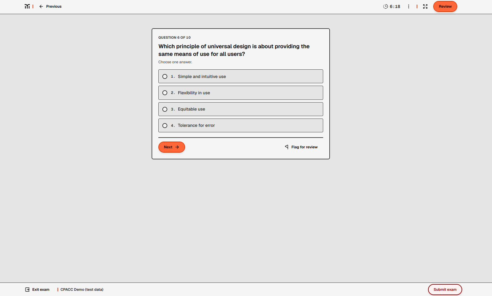

# Mocks

An unofficial, non-commercial, free practice-exam app for multiple-choice exams and quizzes. Take timed practice exams, review explanations, and run the whole thing yourself on Cloudflare.

> Mocks is independent and non-commercial. All certification names and trademarks are property of their respective owners. Scores are practice feedback and do not constitute official results, certification, or a substitute for the official exam.



---

Mocks is built with SvelteKit and Svelte 5, and deploys to Cloudflare Workers with a D1 database. The app and the questions are separate.

The app ships a **10-question demo** so it runs immediately, real exams are installed from version-pinned **content packs**, so you can add or replace content without touching app code.

The look lives in `src/theme/`, so you can rebrand without blocking app updates.

Pick the line that matches what you want to do:

| I want to...                           | Start here                                    |
| -------------------------------------- | --------------------------------------------- |
| Try it without installing anything     | [Preview online](#preview-online)             |
| Run it on my machine                   | [Run it locally](#run-it-locally)             |
| Use the full Mocks CPACC question bank | [Use the CPACC bank](#use-the-cpacc-bank)     |
| Put it on my own domain                | [Deploy to Cloudflare](#deploy-to-cloudflare) |
| Change the branding or content         | [Make it yours](#make-it-yours)               |
| Write my own questions                 | [Create your own bank](#create-your-own-bank) |

## Preview online

The project runs at **[mocks.oxypteros.com](https://mocks.oxypteros.com)** with the Mocks CPACC bank installed. No account, no install. Use it to see what the app is before reading any further.

## Run it locally

Requirements: **Node 26** and **pnpm 12**. You do not need a Cloudflare account until you deploy.

```sh
git clone https://github.com/mocks-org/mocks.git
cd mocks
pnpm install
pnpm wrangler:init       # copies wrangler.example.jsonc to wrangler.jsonc
pnpm db:migrate:local    # creates the local D1 database
pnpm db:seed:demo:local  # loads the 10-question demo
pnpm dev
```

Open the URL Vite prints (usually <http://localhost:5173>) and go to **`/portal/cpacc-demo`**. The homepage shows the demo automatically. That is the whole first run, no pack, no config, no account.

The demo is a fixed 10-question sample. It is not in the content manifest and is not seeded to the remote database by the documented flow, so installing a real pack leaves it alone locally.

If you plan to deploy or customise, **fork** on GitHub (or clone and push to your own remote) instead of working in a bare clone. Your copy then shares history with `mocks-org/mocks`, so `git merge upstream/main` brings fixes while your theme stays yours.

## Use the Mocks CPACC bank

The Mocks CPACC pack is a separate repository, [mocks-org/mocks-cpacc](https://github.com/mocks-org/mocks-cpacc). Install it into your copy and seed it:

```sh
pnpm content:add github:mocks-org/mocks-cpacc --ref <full-commit-sha>
pnpm bank:validate
pnpm bank:seed:local
```

`--ref` is optional: without it the newest release tag is used and its commit recorded. With it, it must be a **full commit SHA**, not a branch or a tag, that is what makes a build reproducible.

Take the newest one from the pack's [releases](https://github.com/mocks-org/mocks-cpacc/releases), then `pnpm content:list` shows what is installed and how many questions each pack holds.

The app reads the database, not the `content/` folder. If you add, update, or remove a pack later, run `pnpm bank:seed:local` again (add `--exam cpacc` to seed just that one) before expecting the running app to change.

`content:add` fetches the pack into `content/cpacc/` and pins it in `content/packs.json`.

Commit both together. That commit is your release record.

Details, including schema-version and allowlist rules, are in [content packs](docs/content-packs.md).

## Deploy to Cloudflare

In short:

```sh
pnpm wrangler:init      # if you have not already
# set the worker name in wrangler.jsonc
pnpm exec wrangler d1 create <database-name>
# paste the printed id into wrangler.jsonc
pnpm db:migrate:remote
pnpm bank:seed:remote --exam cpacc # the pack you want live, not the demo
pnpm build
pnpm exec wrangler deploy
```

- Update the `url` in `src/lib/settings/site.ts` to your domain (it also sets the canonical, sitemap, and robots URLs).
- Enable Actions in the repository settings if you want the content-sync pull requests, and redeploy whenever the site or content changes.

The full walkthrough, including database setup and troubleshooting, is in [Deploy to Cloudflare](docs/deploy.md).

## Make it yours

A fork owner only needs these files:

| Path                       | Purpose                                                                   |
| -------------------------- | ------------------------------------------------------------------------- |
| `src/theme/**`             | palette, fonts, header, footer, homepage and exam-bar layout              |
| `src/lib/settings/site.ts` | name, logo, metadata, nav, footer, homepage copy, licences, featured exam |
| `src/routes/(site)/*.svx`  | about and accessibility prose                                             |
| `content/packs.json`       | which packs are installed, pinned by SHA                                  |
| `wrangler.jsonc`           | worker name and D1 database name/id                                       |

Rebranding is mostly one file. Edit `name`, `tagline`, `description`, `url`, `locale`, `featuredExam`, the link lists, and `social` in `site.ts`. The header, footer, document head, homepage, and authoring defaults all read from it.

Look changes stay in `src/theme/` (`tokens.css`, `Header.svelte`, `Footer.svelte`, `Home.svelte`, `SessionHeader.svelte`).

The `pnpm theme:check` refuses accessibility semantics there on purpose, so fixes in `src/lib/` keep merging into your fork cleanly. Everything outside the table above is app code. If the list grows, treat it as a bug, not as documentation to add.

[Make it your own](docs/fork-your-own.md) walks through the same surface step by step, including editing `content/packs.json` in the browser. [Upgrading a fork](docs/upgrading.md) covers merging upstream and the theme patches that need care.

## Create your own bank

A pack is a directory shaped like `content/<exam>`, containing an `exam.json` and per-kind banks such as `exam/` and `practice/`, each with a `bank.json` and question JSON files. Question IDs must be unique across every loaded pack, and the app supports schema version N and N-1.

Start with [content packs](docs/content-packs.md#write-your-own-pack) for the layout and manifest, then [authoring questions](docs/authoring.md) for the question shape, references, and review workflow.

The `/author` route in the running app is a client-only editor that exports question or bank JSON, commit the exports to a pack repository, **never** to a synced `content/<exam>/` directory.

From a pack repository next to a checkout of the app:

```sh
node ../mocks/scripts/bank/validate.ts .
node ../mocks/scripts/bank/length-audit.ts .
node ../mocks/scripts/bank/link-check.ts .    # network
```

Tag a release (`v0.2.0`, ...) and install it with `pnpm content:add ... --ref <sha>` as above.

## Contributing

- **App code, accessibility, or docs:** [CONTRIBUTING.md](.github/CONTRIBUTING.md).
- **CPACC questions:** [mocks-cpacc/CONTRIBUTING.md](https://github.com/mocks-org/mocks-cpacc/blob/main/CONTRIBUTING.md). Content changes arrive there as pull requests, so a bad sync can be closed without losing data.
- **Bug reports and feature requests:** open an issue on [mocks-org/mocks](https://github.com/mocks-org/mocks/issues).

Accessibility is a first-class concern for Mocks: `pnpm test:a11y` runs axe at 320px and 1280px against the demo pack, and the theme seam exists so accessibility fixes merge without touching anyone's styling.

## Command reference

| Command                   | What it does                                              |
| ------------------------- | --------------------------------------------------------- |
| `pnpm dev`                | Vite dev server                                           |
| `pnpm build`              | generate worker types, strip globals, build               |
| `pnpm preview`            | run the built worker locally on port 4173                 |
| `pnpm check`              | svelte-check with warnings as errors, plus `theme:check`  |
| `pnpm lint`               | Prettier check + ESLint                                   |
| `pnpm test:unit`          | Vitest                                                    |
| `pnpm test:e2e`           | Playwright (builds and previews)                          |
| `pnpm test:a11y`          | axe scans at 320px and 1280px                             |
| `pnpm db:migrate:local`   | apply Drizzle migrations                                  |
| `pnpm db:seed:demo:local` | seed the bundled demo exam                                |
| `pnpm content:add`        | fetch and validate a pack, install it, write the manifest |
| `pnpm content:update`     | move an installed pack to a newer commit                  |
| `pnpm content:list`       | show pinned packs and question counts                     |
| `pnpm bank:validate`      | validate the demo and every installed pack                |
| `pnpm bank:seed:local`    | build and apply question SQL to local D1                  |
| `pnpm bank:seed:remote`   | same, for the deployed database                           |

`package.json` lists the rest, including `bank:build`, `db:migrate:remote`, and the content scripts.

## Licence

- App code: [MIT](LICENSE).
- Question content licence is declared by each pack: The Mocks CPACC Mocks pack uses [CC BY-SA 4.0](https://github.com/mocks-org/mocks-cpacc/blob/main/LICENSE). If you distribute modified Mocks content, share-alike applies. Your own packs can use any licence.
